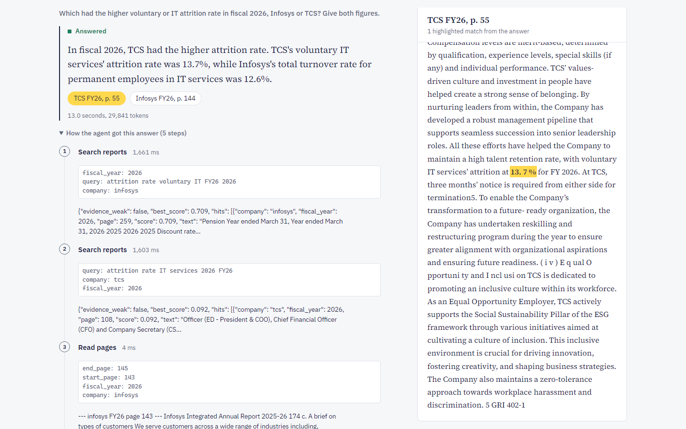
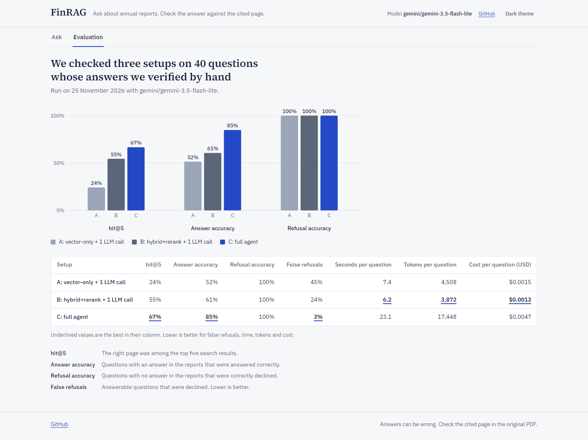
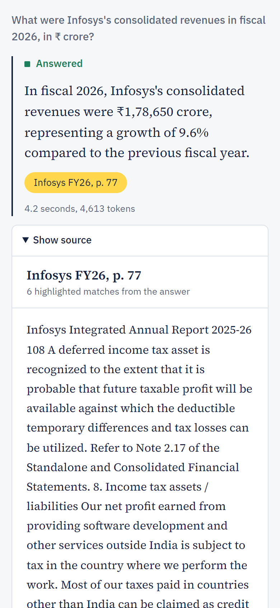
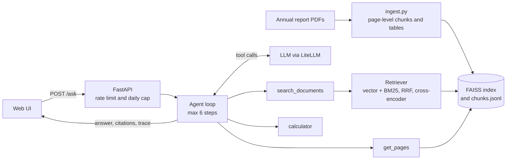

# FinRAG

[](https://github.com/bhargavrrao-web/fin-Rag/actions/workflows/ci.yml)


An agentic research assistant for annual reports. Ask a question in plain English and an LLM
agent searches six Infosys, TCS and Wipro reports, reads the pages it needs, does the arithmetic
and answers with **page-level citations**. The web UI shows the cited page next to the answer
with the exact figure highlighted, so you can check a number in one glance. When the reports do
not contain the answer, it says so instead of guessing.



## What it does

- **Answers with evidence.** Every answer lists citations such as "TCS FY26, p. 55". Selecting
  one opens that page's text in the Source panel with the answer's figures highlighted.
- **Shows its work.** A collapsible timeline lists each tool call (search, read pages,
  calculate) with its arguments, a result preview and its duration.
- **Declines when it should.** Out-of-scope questions, such as forecasts or companies that are
  not indexed, get "Not found in these reports".
- **Measured, not assumed.** A 40-question hand-verified benchmark compares three retrieval and
  agent configurations (see [Evaluation](#evaluation)).

| Evaluation tab | Mobile |
|---|---|
|  |  |

## Evaluation

Run with `python -m eval.run_eval` on 2026-11-25 (model `gemini-3.5-flash-lite`, same model as
judge). 40 questions, each verified by hand against the PDF page: 15 lookups, 10 multi-step
calculations, 8 comparisons and 7 unanswerable questions.

| Config | hit@5 | Answer accuracy | Refusal accuracy | False refusals | Time per question | Tokens | Cost |
|---|---|---|---|---|---|---|---|
| A. Vector search + 1 LLM call | 24% | 52% | 100% | 45% | 7.4 s | 4,508 | $0.0015 |
| B. Hybrid search + rerank + 1 LLM call | 55% | 61% | 100% | 24% | 6.2 s | 3,872 | $0.0013 |
| **C. Full agent (tools, up to 6 steps)** | **67%** | **85%** | 100% | **3%** | 23.1 s | 17,448 | $0.0047 |

What the numbers say:

- Retrieval quality matters most. Moving from vector-only (A) to hybrid search with reranking
  (B) more than doubles hit@5 and halves false refusals.
- Letting the model search again and read whole pages (C) adds the largest accuracy gain,
  especially on comparisons and multi-step questions, at about four times the tokens and time.
- Refusal accuracy is 100% for every configuration, but there are only 7 unanswerable
  questions, so treat that as a sanity check, not a strong result.
- Answer accuracy is judged by an LLM against a hand-written expected answer. It can be wrong in
  both directions. [eval/failure_analysis.md](eval/failure_analysis.md) lists every miss, and some
  C misses look like judge quirks (for example C02, where the answer contains the expected
  18.43% margin).

Per-category accuracy for config C: lookup 93%, multi-step 100%, comparison 50%, unanswerable
100%. Comparisons are the weak spot: they need two or three correct retrievals at once.

## How it works



1. The question goes to the LLM with three tool definitions.
2. The model calls `search_documents` (hybrid search with reranking, optionally filtered by
   company and year), `get_pages` (read up to 3 full pages) or `calculator` (safe arithmetic).
3. Tool results go back to the model. Tool errors return as text so the model can correct itself.
   After at most 6 LLM calls it must answer.
4. The final reply is JSON `{answer, citations, status}`. It is validated with Pydantic, and a
   malformed or empty answer is sent back for one retry.
5. The API attaches the text of each cited page as `passage`, and the UI highlights the figures
   from the answer inside it. Every tool call is recorded and shown in the timeline.

### Retrieval

Search runs vector search (`BAAI/bge-small-en-v1.5` in FAISS) and BM25 side by side. Reciprocal
Rank Fusion merges them using ranks only, so the two score scales need no normalising. The top 20
candidates are scored by a cross-encoder (`ms-marco-MiniLM-L-6-v2`).

The final order blends the first-stage rank with the cross-encoder rank. Ordering by the
cross-encoder alone buried pages that held figures in running text. For example, TCS's FY26
attrition rate (p. 55) ranked 1st to 4th in hybrid search but 8th or lower after reranking. The
score returned with each hit stays the cross-encoder logit, because that value is the signal for
"the evidence is weak".

## Run locally

Requires Python 3.11+ and an API key for any model supported by
[LiteLLM](https://docs.litellm.ai/). The built index is committed, so you can run the app
without the PDFs.

```bash
pip install -r requirements.txt
cp .env.example .env            # set LLM_MODEL and LLM_API_KEY
uvicorn app.main:app --port 7860
```

Open http://localhost:7860. The first request loads both models and can take a minute.

To rebuild the index from the PDFs (about 30 minutes on a laptop CPU), see
[data/README.md](data/README.md) for where to download them, then:

```bash
python -m app.ingest --pdf-dir data/raw
```

Other commands:

```bash
python -m app.retrieval "attrition" --company tcs --year 2026      # try retrieval alone
python -m app.agent "What was Infosys's operating margin in FY25?" # run the agent in the terminal
python -m eval.run_eval                                            # full evaluation (about 25 minutes)
pytest && ruff check .                                             # tests run offline
```

Docker: `docker compose up --build`. Deployment options are in [DEPLOY.md](DEPLOY.md).

### Configuration

All settings come from environment variables (see [.env.example](.env.example)).

| Variable | Purpose | Default |
|---|---|---|
| `LLM_MODEL`, `LLM_API_KEY` | Model and key, via LiteLLM | none |
| `LLM_FALLBACK_MODEL` | Second model used if the main one keeps failing | none |
| `DAILY_LIMIT` | Questions per day across all users | 200 |
| `RATE_LIMIT` | Questions per minute per IP | 10/minute |
| `WEAK_SCORE_THRESHOLD` | Rerank score under which evidence counts as weak | 0.0 |
| `CORS_ORIGINS` | Allowed cross-origin sites (empty means same-origin only) | none |
| `GITHUB_URL` | Repository link shown in the UI | none |
| `LOGFIRE_TOKEN` | Optional tracing | none |

### API

| Endpoint | Purpose |
|---|---|
| `POST /ask` | Body `{"question": "..."}`. Returns `answer`, `status`, `citations` (with `passage`), `steps`, `latency_ms`, `tokens`, `cost_usd`. |
| `GET /api/docs-list` | The indexed reports. |
| `GET /api/eval-results` | Summary of the latest evaluation. |
| `GET /api/config` | Model name and limits. |
| `GET /health` | Liveness check. |

## Project structure

```
app/          config, ingest, retrieval, tools, agent, baseline, main (FastAPI)
app/static/   web UI: index.html, style.css, app.js, self-hosted fonts (no build step)
eval/         questions.json, run_eval.py, results.* and failure_analysis.md
tests/        offline tests (LLM and embeddings are mocked)
data/         processed/chunks.jsonl and index/ (raw PDFs are not committed)
docs/         screenshots used in this README
```

## Design decisions

- **Chunking:** about 350 words with 60 words of overlap, never crossing a page, so every
  citation maps to exactly one page. Tables are separate chunks, split by row with the header
  repeated, so numbers keep their column meaning.
- **Hybrid search:** vector search finds paraphrases, BM25 finds exact terms such as figures and
  names. Rank fusion combines them without score normalisation.
- **No agent framework:** the loop is about 100 readable lines, so every step is visible and
  there is no hidden prompt to debug.
- **Refusal:** the best rerank score is compared with a threshold. Below it, the tool result
  says the evidence is weak and the model is told to try once more and otherwise answer
  `not_found`. The model makes the final call.
- **Safe calculator:** arithmetic walks Python's `ast` with an allow-list. There is no `eval`, so
  an injected expression cannot run code.
- **Plain front end:** HTML, CSS and vanilla JavaScript with no build step. The conversation is
  kept in memory only. Passage text is inserted as DOM text nodes, never as HTML.

## Limitations

- **Retrieval is the weak point.** hit@5 is 67% for the full agent. Pages with figures inside
  long tables or running text can still be missed, so the same question can occasionally return
  different results between runs. Comparisons are the least reliable category.
- **PDF text is messy.** Text extraction splits some numbers (`13. 7`) and TCS's FY25 report
  loses many digits to a font-encoding problem. The UI tolerates split decimals when
  highlighting, but OCR would fix the cause. Scanned pages are not supported.
- **Highlighting is a text match.** The UI marks figures from the answer that appear in the cited
  page. If the answer states a derived value, such as a computed growth rate, nothing may be
  highlighted and the panel says so.
- **Citations are not cross-checked.** They come from the model and are not verified against the
  pages it actually read.
- **Small benchmark.** 40 questions across 6 reports, with an LLM judge from the same model
  family. Differences of a few points are within noise.
- **Free-tier realities.** LLM providers rate limit and sometimes return 503. The daily cap is
  in memory and resets on restart. The first request after startup is slow while models load.

## Next steps

Cross-check citations against retrieved pages, add OCR, evaluate a stronger judge model and a
better reranker, and add more companies and years.
