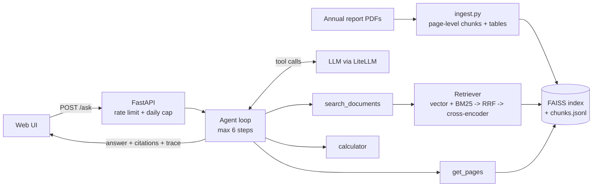

# FinRAG Agent

An agentic RAG research assistant over annual-report PDFs of Indian IT companies. You ask a
question in plain English; an LLM agent decides whether to search the reports, read specific
pages or do arithmetic, then answers **with page-level citations** (company, fiscal year, page).
When the evidence is weak it says **"not found"** instead of guessing. The retrieval strategies
and the agent are compared in a measured evaluation (see Results).

**Live demo:** TBD (see [DEPLOY.md](DEPLOY.md))  |  **Screenshot:** TBD

## Architecture



## How the agent works

1. The question goes to the LLM together with three tool definitions.
2. The model may call `search_documents` (hybrid search + rerank, optionally filtered by
   company/year), `get_pages` (read up to 3 full pages) or `calculator` (safe arithmetic).
3. Each tool result goes back to the model. Tool errors are returned as text so the model can
   fix its own mistake. After at most 6 LLM calls the model must answer.
4. The final reply must be JSON `{answer, citations, status}`; it is validated with Pydantic and
   retried once if malformed.
5. Every step is recorded (tool, arguments, preview, milliseconds) and shown in the UI.

## Results

Numbers appear here only after a real run of `python -m eval.run_eval` on questions I verified by
hand against the PDFs. **Status: TBD, the evaluation has not been run yet.**

| Config | hit@5 | Answer acc. | Refusal acc. | Avg latency | Avg tokens |
|---|---|---|---|---|---|
| A) vector-only + 1 LLM call | TBD | TBD | TBD | TBD | TBD |
| B) hybrid+rerank + 1 LLM call | TBD | TBD | TBD | TBD | TBD |
| C) full agent | TBD | TBD | TBD | TBD | TBD |

Failure analysis summary: TBD (the full per-question list will be in `eval/failure_analysis.md`).

## Data

Six reports (Infosys, TCS, Wipro; FY25 and FY26) are indexed: 6,362 chunks. See
[data/README.md](data/README.md) for sources and the file naming. Citation pages are PDF-viewer
page numbers, not the numbers printed on the pages.

## Tech stack

PyMuPDF, sentence-transformers (`BAAI/bge-small-en-v1.5`, `cross-encoder/ms-marco-MiniLM-L-6-v2`),
FAISS, rank_bm25, LiteLLM, FastAPI + Pydantic v2 + slowapi, vanilla HTML/CSS/JS, Pydantic
Logfire (optional), pytest, ruff, GitHub Actions, Docker.

## Run locally

```bash
pip install -r requirements.txt
cp .env.example .env          # set LLM_MODEL and LLM_API_KEY, then put PDFs in data/raw/
python -m app.ingest --pdf-dir data/raw && uvicorn app.main:app --port 7860
```

Open http://localhost:7860. Other commands:

```bash
python -m app.retrieval "total revenue" --company infosys --year 2024   # try retrieval
python -m app.agent "What was the operating margin?"                    # try the agent in the terminal
python -m eval.run_eval                                                 # run the evaluation
pytest && ruff check .                                                  # tests run fully offline
```

## Project structure

```
app/        config, ingest, retrieval, tools, agent, baseline, main (FastAPI), static/ (UI)
eval/       questions.json, run_eval.py, results.* and failure_analysis.md (generated)
tests/      offline tests (LLM and embeddings mocked)
data/       raw/ (PDFs, not committed), processed/chunks.jsonl, index/ (FAISS + meta.json)
```

## Design decisions

- **Chunking:** ~350 words (about 470 tokens) with 60 words overlap, never crossing a page, so
  every citation maps to exactly one page. Sizes are counted in words to avoid needing a
  tokenizer; 350 words stays under the embedding model's 512-token limit. Tables are separate
  chunks, split by row with the header repeated, so numbers keep their column meaning.
- **Why hybrid:** vector search finds paraphrases, BM25 finds exact terms (figures, names,
  "Form 20-F"). Reciprocal Rank Fusion combines them using ranks only, so the two score scales
  never need normalising.
- **Why a reranker:** a cross-encoder reads the query and the passage together, which is more
  accurate than comparing two separate embeddings, but too slow for every chunk, so it only
  reorders the top 20 fused candidates.
- **Why no LangChain/LlamaIndex:** the whole agent is about 100 readable lines. Every step is
  visible and explainable, and there is no hidden prompt or abstraction to debug.
- **How refusal works:** the reranker score of the best hit is compared with a threshold. If it is
  below, the tool result says the evidence is weak and the system prompt tells the model to try
  one more search and otherwise answer `not_found`. The model makes the final call. The threshold
  must be calibrated on real scores from the evaluation (the default is a placeholder).
- **Safe calculator:** arithmetic is evaluated by walking Python's `ast` with an allow-list. No
  `eval`, so a prompt-injected expression cannot run code.

## Limitations

- Only text-based PDFs: scanned pages would need OCR. Table extraction can be noisy on complex
  layouts.
- Some PDFs extract badly. In the TCS FY25 report many digits come out as `?` (a font-encoding
  problem), so figures from that report can be unreadable to the model. OCR would fix it.
- hit@5 counts a hit only when an expected page is retrieved, but the same figure often appears on
  several pages, so retrieval quality is understated.
- Free LLM tiers are rate limited (requests per minute and per day), so the demo caps questions
  per day and the evaluation paces its requests.
- The daily cap lives in memory and resets when the server restarts.
- Chunk sizes are in words, not exact tokens.
- Citations come from the model and are not automatically cross-checked against the pages it saw.
- Evaluation quality depends on the hand-verified question set and an LLM judge (which can be
  wrong; 15 judged answers are sampled for manual re-checking).

## What I would do next

Cross-check citations against retrieved pages, add OCR, tune chunk size with the evaluation
harness, add a stronger separate judge model, and support more companies and years.
